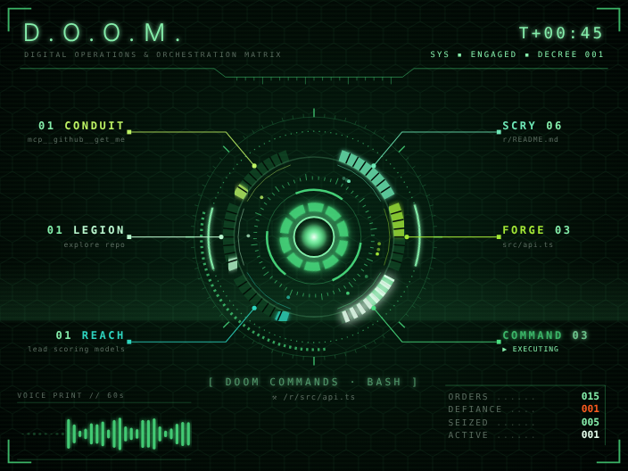

# D.O.O.M. — Digital Operations & Orchestration Matrix

A Claude Code mod that adds a live, JARVIS-style holographic HUD in Doom green beside the chat. While Claude Code works, it shows every tool call as it happens: an arc-reactor core that pulses while Claude thinks, six system gauges (SCRY for reads and searches, FORGE for edits, COMMAND for shell, REACH for web, LEGION for subagents, CONDUIT for connected tools) with callouts naming what each last touched, a voice-print waveform of the last minute's activity, error and file tallies, and a running log of each call with its target and duration.



The pane opens by itself when a session starts; `/radar` opens it again. In a terminal it draws a text version with spinners and bar gauges.

## Install

At the prompt of a terminal session:

`/plugin install doom-interface --marketplace carsonxo2000/doom-interface`

From a shell:

`claude plugin install doom-interface --marketplace carsonxo2000/doom-interface`

In the desktop app, where `/plugin` does not run: click + next to the prompt box, then Plugins, Add marketplace with `carsonxo2000/doom-interface`, then Add plugin.

## Mac desktop launcher

Paste this into Terminal. It installs or updates the plugin (when Claude Code's command line is installed) and puts a **Doom Interface** app with its own icon on your Desktop:

```bash
bash -c "$(curl -fsSL https://raw.githubusercontent.com/carsonxo2000/doom-interface/main/mac/install.sh)"
```

The app opens the HUD in a window of its own (a chromeless window in Chrome, Edge or Brave when one is installed, Safari otherwise), live with whichever Claude Code session on your Mac is working. The plugin's ordinary hooks run `scripts/doom-event`, which appends each event to `~/.claude/doom-interface/events.js` using only tools macOS ships (`plutil`, `perl`); the page reloads that file every second and draws the HUD with `viewer/hud.js`. With no session running it waits for a link. Sessions that were already open pick up an update when they restart. The launcher is built on your Mac by `osacompile`, so macOS opens it without a security warning.

## Development

`hooks/hud.ts` draws the HUD for both the pane and the window. After changing it, run `scripts/build-viewer.sh` (needs `tsc`) to regenerate `viewer/hud.js`.

## License

MIT
